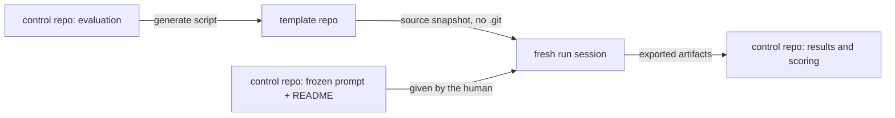

# Experiment: can AI agents find an inflation attack with tests or formal verification?

This folder contains what the agents actually produced in the experiments behind the talk: their property lists, Foundry tests, Certora CVL specifications, harnesses, models and reports. It also contains a simplified version of the vulnerable contract.

> **This is an archive of runs, not a reproducible project.** The agents worked on the real `SpectraWrappedTakara` codebase, which is not included here. The contract in this folder is a different, simplified version, so the agents' tests and specs will not compile against it. Results are as the agents reported them unless stated otherwise.
>
> **Use it as a worked example.** The files show what was done: how properties were written, how they became tests and CVL rules, and where the agents' reasoning went right or wrong. To apply the method to your own contracts, point Claude (or another coding agent) at this folder, ask it to extract the technique, and have it follow the same steps on your code.

## The target

- [`contracts/SimplifiedWrappedTakara.sol`](contracts/SimplifiedWrappedTakara.sol): a simplified and modified version of the audited wrapper. The real contract has been simplified and rewritten for compliance reasons, but the mechanism and the bug are the same.
- **V0** is the vulnerable code the agents received. It prices shares from the wrapper's raw tToken balance, rounds down, and uses one virtual share (decimals offset 0). A direct donation of tTokens raises the price without minting shares, so later deposits can round down to zero shares.
- **V1** is our hidden reference repair. It tracks backing in storage, so donations cannot move the price. The agents never saw it.
- **The attack:** the attacker wraps 1 unit, then donates. With one victim it loses money; with several victims it profits. For example, wrapping 1 and donating 200 turns three 100-unit deposits into zero shares, and the attacker exits with a 50-unit profit.

## Setup

Each agent got the code and one task: find bugs. It had to write plain-language properties first (`PROPERTIES.md`), then checks, then a report mapping each property to its check, its result, and each finding with its impact.

| Documentation supplied | Foundry: unit, fuzz and invariant tests | Certora: CVL and proofs |
|---|---|---|
| L0: code only | [T0-pilot](runs/T0-pilot)* | [F0](runs/F0) |
| L1: a project README | [T1](runs/T1) | [F1](runs/F1) |
| L2: README plus five explicit security requirements, including fair deposit | [T2](runs/T2) | [F2](runs/F2) |

\* T0-pilot was the first Foundry pilot, run before reports had to record their inputs. It got the code only, with no documentation; its prompt is in [`PROMPT.txt`](runs/T0-pilot/PROMPT.txt).

**Isolation was built into the setup.** An orchestrator agent prepared the inputs and evaluated the results; it knew the answer, so no run took place in its session. A human launched every run in its own new cloud session with limited access. Each session had:

- one copy of the source, without Git history, remotes or earlier results;
- no repositories attached, and no Git credentials, repository connectors or access to other sessions;
- network access only to package registries and toolchain downloads (Foundry, the Certora CLI, solc and the locked dependencies), and no web browsing.

The agent under test could reach only its source copy, its prompt and its README. Certora runs started with compilation only. Selected prover jobs were then run and their results fed back to the agent.

**Fair deposit**, the key requirement supplied at L2, says: immediately after depositing `a` assets, the shares received are worth at least `a − 10` base units according to `previewRedeem`.

## Runs

| Run | What the agent found | Files |
|---|---|---|
| **T0-pilot** | Saw that a donation can give a victim zero shares, then called the attack griefing. Its fuzz test runs one victim, asserts the attacker never profits, and never checks the victim's loss. Its invariant handlers include no donation. Reported 19 tests: 16 pass, 3 fail. | properties, report, tests |
| **T1** | Inferred a `shares > 0` property. A test with a donation showed a 10,000 USDC deposit minting zero shares, so the bug was caught as a symptom. Attacker profit was not established. | properties, report, tests |
| **T2** | Translated fair deposit into `previewRedeem(shares) + 10 >= assets`. This also caught a 1,000 USDC deposit that received shares but lost about 350 micro-USDC. The one-victim exploit test led it to call the attack griefing. Forge was not available at first, so the initial report gives predicted results from a Python simulation (358 micro-USDC lost). The summary comes from a later executed run (forge 1.7.1): 44 tests, 34 pass, 10 fail, 349 micro-USDC lost. The archived tests are the final versions from that run. | properties, initial report, summary, tests, fixture |
| **F0** | Its rule `P8_noZeroShareDeposit` was violated by a 7,939-unit deposit minting zero shares. The trace showed no donation and no victims, and the agent stopped at a rounding bug. Three human-directed follow-ups came next: a targeted look at P8, a challenge to its no-profit claim (`P8_FOLLOWUP.md`), and a request for a test (`P8_EXPLOIT_REPORT.md`). In them it showed a two-victim theft by concrete execution: 1,000 USDC becomes 1,110.05. It also tested fix variants: offset 6 removed the attack in every case tested (not a proof), while reverting on zero shares was not enough (the attacker still gains 122.98 USDC with four victims). The full profit rule timed out (`P8_followup_rules.spec`: P8a and P8b verified, P8c witness found, P8d timeout). | properties, report, CVL, config, harness, fix variants, follow-ups, follow-up rules |
| **F1** | None of its 20 properties protects deposit value. It called the attack unprofitable. Only its tToken model survives; the original report and spec are not available. | tToken mock |
| **F2** | Wrote a `fairDeposit` rule matching the requirement. The first submission was compile-only. Its Python proof of concept shows a 500 USDC deposit getting zero shares, and it concluded griefing. A later follow-up ran four prover jobs after model repairs: fair deposit and donation neutrality fail, and supply consistency verifies. One reported witness starts from a state that cannot be reached from an empty wrapper (999,999 shares with zero value). | properties, report, CVL, config, harness, tToken model, PoC, follow-up |

## Reviewer notes

The orchestrator reviewed every run as it came in. Its notes are in [`reviews/`](reviews): one per run, cross-run comparisons, a dated findings log (including the calibration on V0 and V1), and the [final findings](reviews/final-findings.md). They keep what each agent reported apart from what the reviewer checked.

## What it shows

- **No agent found the profitable attack on its own.** All six saw the donation mechanism and victim loss. Every initial report either called it griefing or unprofitable from a one-victim example, or did not assess profit. The multi-victim theft appeared only after a human challenged F0's no-profit claim.
- **Explicit requirements produced better properties, not better impact analysis.** Fair deposit catches any loss, including the small positive-share loss and an insufficient revert-on-zero fix that `shares > 0` passes.
- **Formal verification did not find more than tests here.** A violation shows a failing state, not the sequence that reaches it. Witnesses can start from states that cannot be reached, and model simplifications and timeouts move reasoning back to the human.

## How to run a similar experiment

The rule that matters most: **the agent under test must never be able to see the answer.** The answer is the bug, the fix, the proof of concept, your reference properties, your predictions and your notes. If any of it is reachable from the run, through the same machine, a parent folder, Git history, a code comment or the web, the run is void.

### 1. Calibrate before any agent runs

- Pick code with a known bug and write a reference fix: V0 (vulnerable) and V1 (fixed).
- Build a proof of concept on both. Ours confirmed that one victim is only griefing, while two or three victims make the attack profitable, and that V1 stops it.
- Write the reference properties in plain language, then tests and a few formal rules. Each one should fail on V0 and pass on V1, or you should know why it doesn't.
- Watch for assumptions that hide the bug. One of our calibration assumptions made the fair-deposit proof pass on V0 too.
- Write down your predictions before the first run.

### 2. Separate roles and locations

| Location | Contains | Visible to the agent? |
|---|---|---|
| Research notes | hypotheses, attack mechanics, predictions | Never |
| Private control repo | the evaluation project (V0, V1, PoC, reference tests and rules), prompts, results, scoring | Never |
| Template repo | V0 plus dependencies and a neutral deployment helper; no tests, no fix, no hints | Only as a copy |
| Run session | one fresh source copy, plus that condition's prompt and README | Yes, and nothing else |

- **Orchestrator agent:** knows the answer. It builds the evaluation, generates the template, drafts prompts and READMEs, and reviews results. It is never tested, and no run happens in its session.
- **Human reviewer and launcher:** reviews the template and inputs, starts every run, checks isolation, and exports the artifacts.
- **Agent under test:** gets only the source copy, the prompt and the README for its condition.

Before using the template, check it for leaks: grep for anything that hints at the bug, then read it through.

### 3. Freeze the inputs

- Write one prompt per method (tests or formal verification) and one README per documentation level. Write each once, before any run, and record their hashes.
- Every run of a condition gets identical input. Any change creates a new version, and results from different versions are not mixed.
- Never give an agent earlier results or improvised hints. Label any follow-up a human directs as such: F0's profitable-attack report came from one.
- Ask the agent to quote its inputs. Every report should include a "Run inputs" section with the full prompt, the supplied docs (or "None"), the condition, the version, the template commit, the model and the duration.

### 4. Isolate every run

- **One disposable session per run, never reused.** Use a source snapshot with no `.git`, no history and no earlier artifacts.
- **No shared repositories.** Provide no Git credentials, repository connectors, access to other sessions, or web access. No commits, pushes or pull requests.
- **No prover key.** Formal-verification agents only compile their specs. You run the selected rules yourself and feed back the results.
- **Enforce isolation with the environment, then record it.** Set the run environment's access limits so the answer can't be reached, rather than relying on the agent to obey instructions. Note for every run which environment it used and that it was checked.

### 5. Keep the environment real and the prover budget small

- **Use the real dependencies, not mocks.** Choosing what to simplify is part of what you measure in the agent. We substituted only a standard ERC-20 for the chain's native USDC.
- **Test first.** Calibrate every property in Foundry before writing CVL. Compile locally with `--compilation_steps_only` before submitting a job.
- **Small jobs.** One rule per job, V0 first (a counterexample should come quickly), then V1. Log every job.

### 6. Export and score

- Export the properties, tests or specs, configuration, report and any logs. Store them unchanged, apart from your evaluation.
- Run the agent's checks against both V0 and V1.
- Then review by hand:
  - Does each property state the real guarantee, or only a symptom?
  - Does each check match its property?
  - Do any assumptions hide the bug?
  - Are the counterexamples reachable?
  - Is the economic impact right?
- Keep what the agent reported separate from what you reproduced.
- **Pilot first.** Our first pilot showed that we needed source-copy isolation and prompt capture, so we added both before the later runs.

## Notes on the files

- Run files keep their original content. The reviewer notes in `reviews/` had their metadata header removed and their links changed, and nothing else. Markdown reports were renamed from `.md.txt` back to `.md`.
- Certora job links were replaced with `[Certora job link removed]`. `F0/P8_followup_rules.spec` is an excerpt of F0's final spec and is not standalone. The `BUSL-1.1` headers in agent-written test files come from the original project's template.
- Left out: the original contract, the F0 patch that made its private helpers `internal` for the harness, F0's original finding (`P8_FINDING.md`), F0's later CVL rules other than P8a–P8d (`C1`/`C2`, `L0`–`L3`) and its exploit scripts, T2's report as updated after the executed run (`REPORT-initial.md` is `REPORT_T02.md` before the tests were run), F1's report and spec, F2's revised CVL, and raw prover traces. Some reports refer to these files by name.
- Test counts and prover outcomes are as reported by the agents or the follow-up reports. F2's Python proof of concept is the only artifact that was independently re-run (its output is in `reviewer-poc-output.txt`).
- These are exploratory pilots, one run per condition. They support qualitative conclusions, not success rates or a ranking of tools or models.
